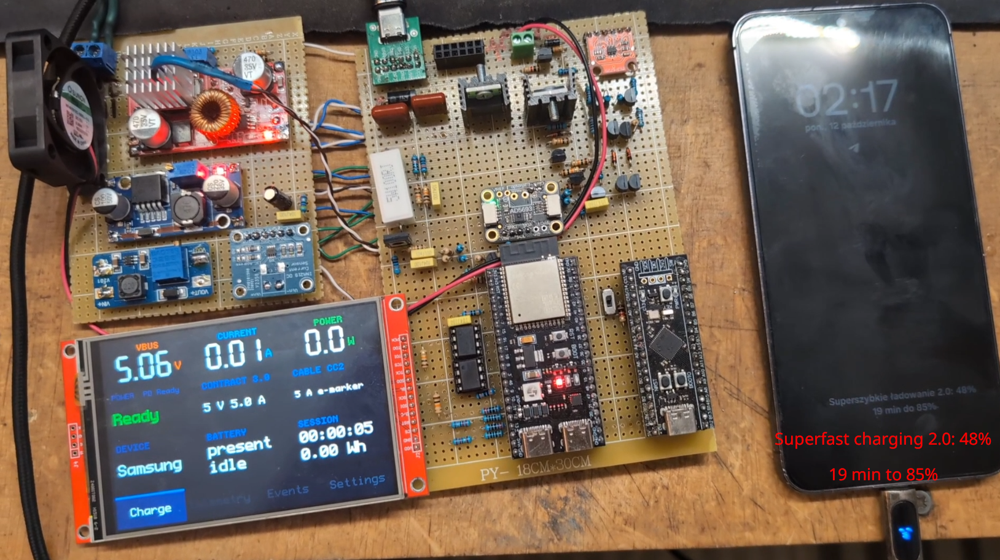
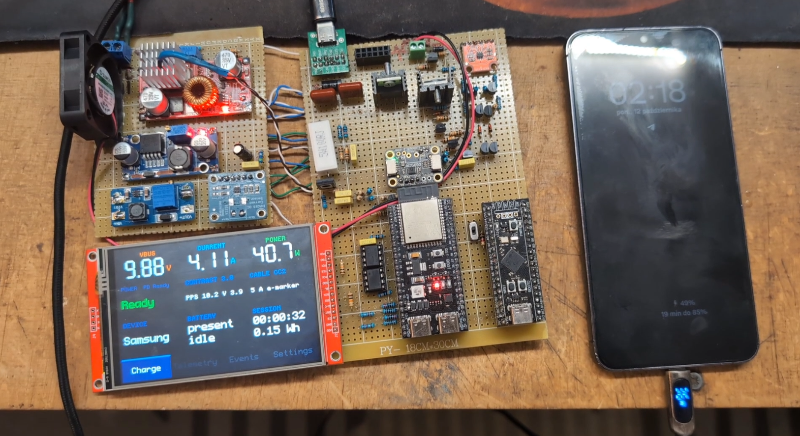
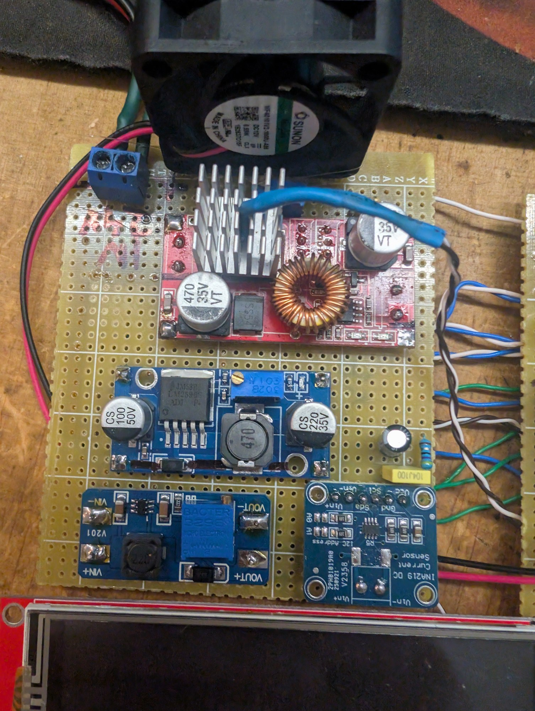
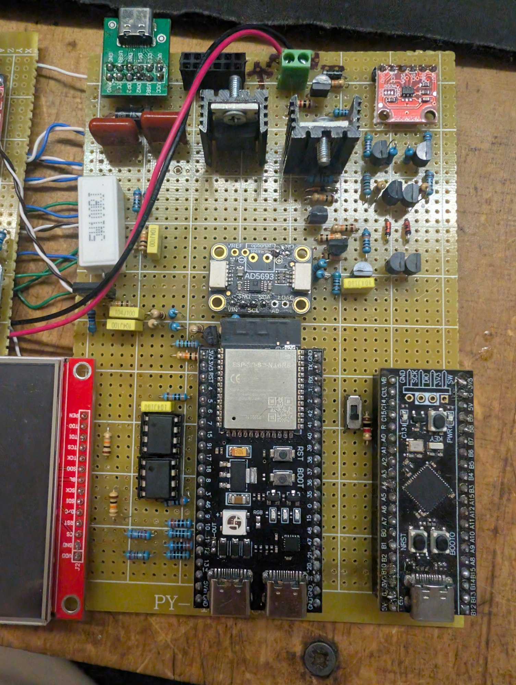
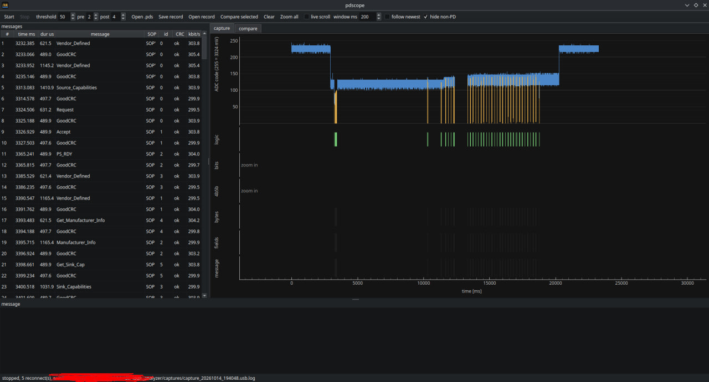
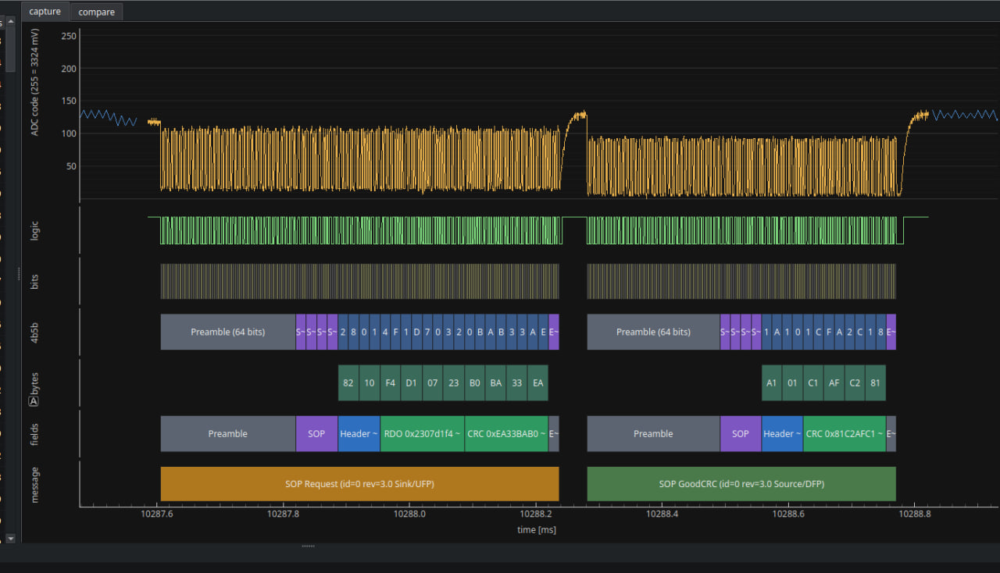
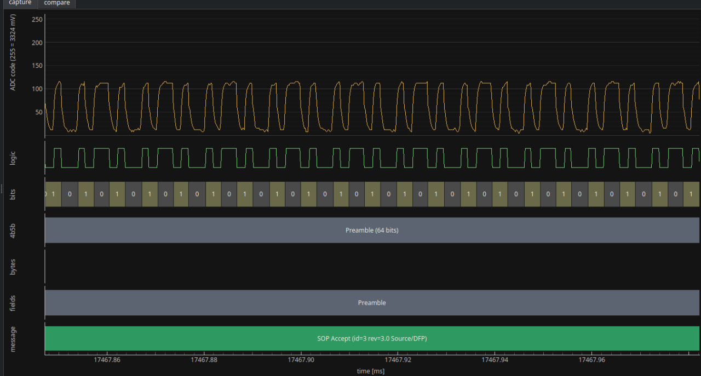
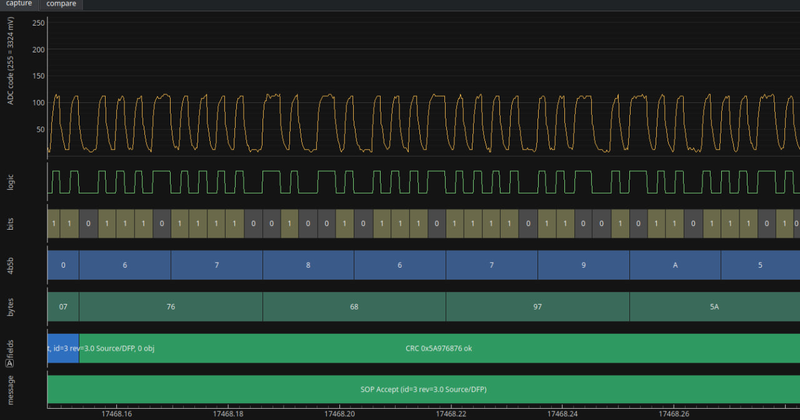

# USB-C Power Delivery Source without any dedicated IC

This project is a USB-C Power Delivery source made using ESP32-S3, two LM311P and some resistors
and transistors. No dedicated Power Delivery IC was used to make this possible.

## What is it / why?

I wanted to make a power delivery source but I don't really like SMD, and there was no real power
delivery solution that was not using a dedicated (SMD) IC. This is why I designed this
charger, one that only uses one comparator and a few resistors to RX/TX per CC line.

## What works?

- PD 3.2, Fixed, PPS with current limit, SPR AVS.
- E-marker detection using SOP'.
- Different source capabilities when using e-marker than without it.
- Collision avoidance by switching the Rp pull-up (SinkTxOk / SinkTxNG).
- Queries to the device (Manufacturer info, Battery status, Status, etc.)
- GoodCRC within spec (about 50us, spec allows up to ~200us)
- Tested with a Samsung phone, IP2721 trigger board and a 9V induction charger.

## How it works?

- TX is made using a resistor divider and I2S peripheral with direct memory access (DMA)
- RX is made using LM311P comparator and RMT peripheral, with streaming decoder in firmware
- GoodCRC is made using a precomputed table
- CC Protection is made using three 2N7000
- Power Supply is made with XL4015 that's controlled by AD5693R DAC (Voltage) and MCP4725 DAC (Current)
- The current is measured with INA219 and 0.05 ohm shunt (instead of the original 0.1 ohm one)
- VBUS is keyed with two IRLZ44N controlled by 27V

## Hardware

  
  

The main power supply is 24V 200W (120W should be enough though but 200W was cheaper at the local store :P).
The project is made on a perfboard and is a working prototype.
Pin map and every block with its values: [docs/hardware.md](docs/hardware.md).
Display, web page, OTA and the rest: [docs/accessories.md](docs/accessories.md).

> [!IMPORTANT]
> **The converter was calibrated to the DAC with an external multimeter.**
> That's what makes the DAC setting a known output voltage, so the ESP's ADC can be calibrated against it at every boot.
> Details in [docs/hardware.md](docs/hardware.md#power-stage).

## Things I learned the hard way

They are described in [docs/lessons.md](docs/lessons.md).

## Tools

I made a PD scope on an STM32 Blackpill because my Hantek oscilloscope broke in the middle of prototyping.
All measurements included in this repo were made with that scope, and the STM32 board was doing nothing more here.
All logic and features are controlled by the ESP32-S3.

## Roadmap

I want to release the code for the board in a form of a rust library, but it needs more time to polish and testing.
Currently I have it working on both sink and source devices.

The library will be GPL-3.0, with a commercial license available for closed firmware.

I am also building a web decoder for PD captures, so you can paste a hex dump, a logic analyzer export 
or plug in the scope and read the whole negotiation in your browser. If you want a ping when it is live,
or you have captures from chargers and cables that misbehave, write to me: `oktawia.handerek@gmail.com`

## Prior art

g3gg0 did USB PD on an ESP32 with the RMT peripheral before me, as a sink and
a sniffer: [Bit-Banging The USB-PD Protocol](https://hackaday.com/2025/01/10/bit-banging-the-usb-pd-protocol/).
This project is the other side: a source, with PPS, up to 5 A with an e-marked cable.

## Safety

This is a prototype. A bug in the firmware can put 20 V on the port.
Test with devices you can afford to lose. The board has CC protection, a TVS
on VBUS, a fault latch and a hardware watchdog that opens the VBUS switch
(see [docs/accessories.md](docs/accessories.md)), but that is not a
certification.

## License

Everything in this repository (docs, photos, schematics and their scripts) is licensed under
[CC BY-NC-SA 4.0](LICENSE). You can build it, change it and share it for non-commercial use, as long as
you credit me and share your changes under the same license.
If you want to use it commercially, write to me first: `oktawia.handerek@gmail.com`

I also take fixed-price PD work. I can make a negotiation diagnosis from a capture, or add
source/sink integration into your own MCU firmware.

## Disclaimer

The firmware was made with the help of an AI. 
