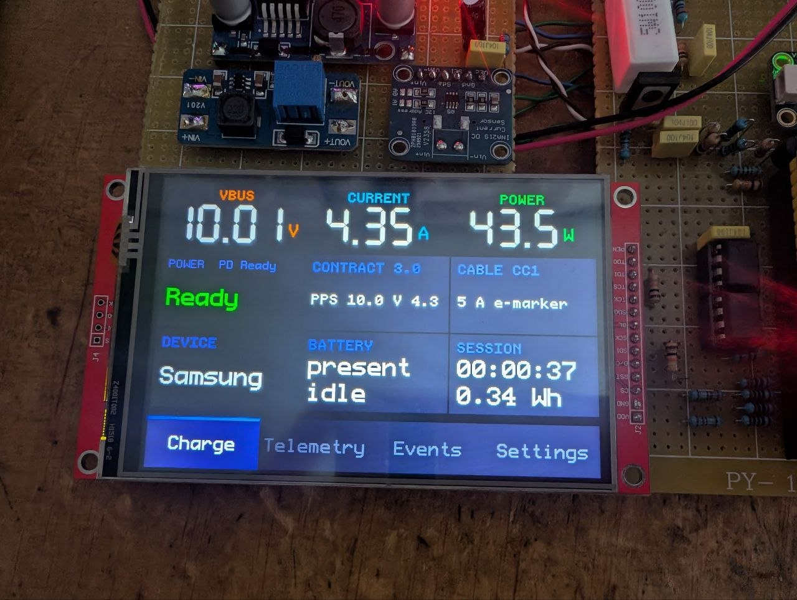
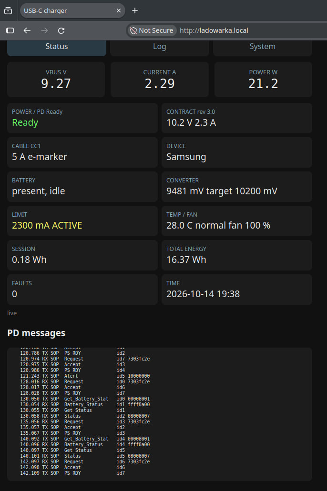
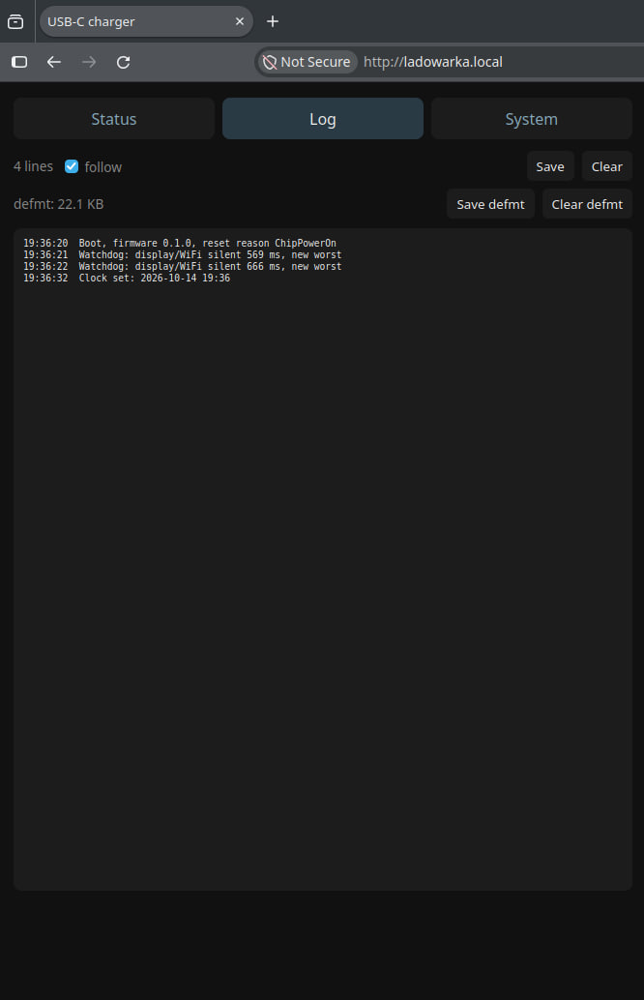
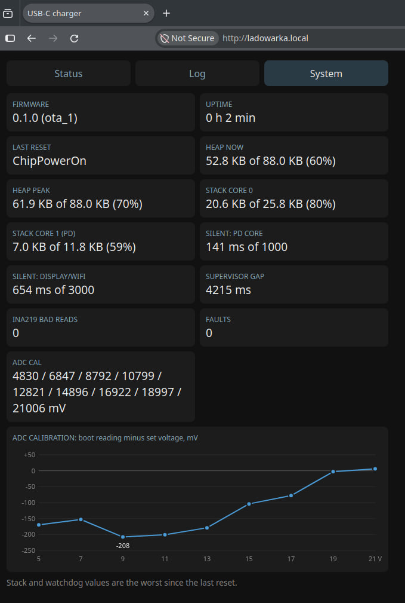

# Accessories

Everything on the board that isn't USB PD itself.
Most of it started as "it would be nice to see what's going on" and then got out of hand :P

## Display

- 4" ILI9488 (480x320, SPI) with an XPT2046 touch panel.
- Pages:
  - **Charge:** VBUS, current, power, contract, cable, device name, battery state, session time and energy.
  - **Telemetry:** converter voltage, target, DAC, current limit, total energy, temperature.
  - **Events:** PD and power events with time.
  - **Settings:** fan mode, touch calibration, WiFi.
- Touch calibration and settings are kept in flash, so they survive a reset.

*The Charge page with the Samsung on PPS 10 V / 4.35 A and a 5 A e-marked cable.*

## Web page

`http://ladowarka.local` on the local network ("ladowarka" is Polish for "charger").
Three tabs, all updating live.

  
  
  

- **Status:** the same values as the display, plus the converter voltage and its target, the PPS
  current limit (and whether it's active right now), temperature and fan, faults, total energy and the clock.
  Below that a live list of PD messages: time, RX/TX, SOP, type, MessageID and the first data object.
  On the screenshot the Samsung asks for 10.2 V / 2.3 A over PPS and checks the battery every few seconds.
- **Log:** the text log (boot with firmware version and reset reason, watchdog records, clock, faults...)
  with Save and Clear. The raw defmt log is kept next to it, also with Save and Clear.
- **System:** firmware version and OTA slot, uptime, last reset reason, heap now and at peak, stack of
  both cores, the longest silence of the PD core and of the display/WiFi side, the supervisor gap,
  INA219 bad reads and faults. The stack and watchdog values are the worst since the last reset.
- The System tab also shows the ADC calibration from this boot: 9 points and a chart of the raw
  reading minus the voltage set by the DAC. The raw ADC is off by up to ~200 mV, so the table is not optional.

## WiFi setup

- With no saved network the board opens its own WiFi called "Ladowarka", with a setup page at `http://192.168.4.1/`.
- To forget the network, tap the WIFI tile on the display twice within 5 s.
- The clock is set from NTP.

## Logs

- defmt log over TCP: `nc ladowarka.local 19021 | defmt-print -e <elf>`, or saved from the Log tab.
- Every PD message gets logged as `PD rx/tx SOP <name> id <n> <first object>`, and every Hard Reset
  of mine comes with a reason. This saved me more times than I can count.

## OTA updates

- `./ota.sh ladowarka.local` builds, signs and sends the firmware over WiFi.
- `./ota.sh keygen` makes a new Ed25519 key pair.
  The public key is built into the firmware, so flash once over USB after you change it.
  Make your own pair, keys don't go into the repository.
- The board checks an Ed25519 signature over the version and the SHA-256 of the image, and refuses
  an older version than the one installed.
- The update is refused while a sink is attached.
  Updating a charger that's charging something sounded like a bad idea.

## Safety

- Hardware watchdog (TIMG1, 3 s). It only gets fed while both the PD core and the display/WiFi side are alive
  (the PD core may stay silent for at most 1 s, the display/WiFi side for 3 s).
  A reset drops GPIO15, which opens the VBUS switch, so a hung firmware can't leave 20 V on the port.
- Power supervisor: overvoltage, undervoltage, overload, VBUS with the switch open, temperature.
  Repeated faults latch the output off until the BOOT button is pressed.

## Fan and energy

- Fan on PWM, automatic from the converter temperature, or always on.
- Energy counter for the session and in total.
  The total gets saved to flash after a detach, not while charging, to save the flash.
