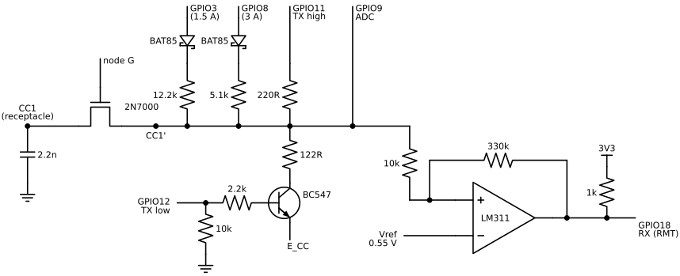
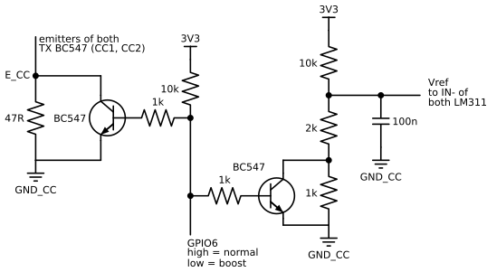
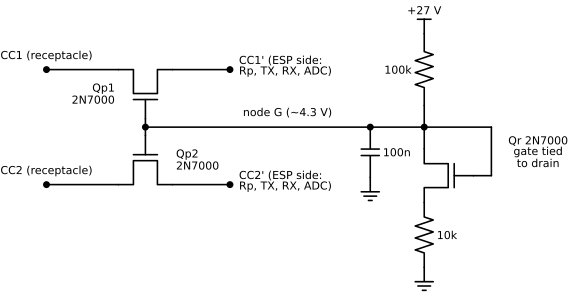
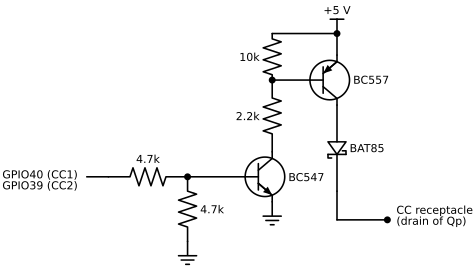
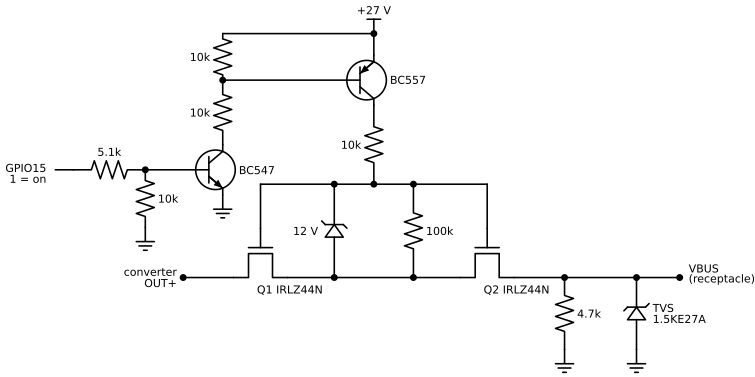

# Hardware

Everything is on perfboard, so no Gerbers here, sorry :P This is the pin map and every block with its values.
Schematics of the main blocks are in [schematics/](../schematics), drawn in Python with Schemdraw.

## Overview

```
24 V PSU --+-- XL4015 step-down (CV set by AD5693R, CC set by MCP4725)
           |       |
           |    0.05 Ohm shunt (INA219) -- VBUS switch (2x IRLZ44N) -- USB-C VBUS
           |
           +-- LM2596 -> 5 V (ESP32-S3, LM311)
           +-- MT3608 -> 27 V (gates of the VBUS switch and the CC protection)

ESP32-S3 --- I2S TX + RMT RX --- CC front end (x2) --- 2N7000 --- USB-C CC1/CC2
```

- Main supply: 24 V / 200 W (120 W would be enough, 200 W was just cheaper).
- ESP32-S3 dev kit sold as N16R8, which turned out to have no PSRAM, so keep PSRAM disabled.

## Pin map

| GPIO   | Signal                                                        |
|--------|---------------------------------------------------------------|
| 0      | BOOT button (clears the fault latch)                          |
| 1      | I2C SDA: AD5693R 0x4C, MCP4725 0x60-0x63, INA219 0x40         |
| 2      | I2C SCL                                                       |
| 3      | Rp 12.2k leg, both CC lines (SinkTxNG, 1.5 A)                 |
| 4      | ADC: converter output                                         |
| 5      | ADC: VBUS behind the switch                                   |
| 6      | Ground offset boost (high = normal, low = boost)              |
| 7      | ADC: NTC                                                      |
| 8      | Rp 5.1k leg, both CC lines (SinkTxOk, 3 A)                    |
| 9      | ADC: CC1                                                      |
| 10     | ADC: CC2                                                      |
| 11     | CC1 TX high (I2S DOUT, 220R)                                  |
| 12     | CC1 TX low (BC547 base, 2.2k)                                 |
| 13     | CC2 TX high (I2S DOUT, 220R)                                  |
| 14     | CC2 TX low (BC547 base, 2.2k)                                 |
| 15     | VBUS switch (1 = closed)                                      |
| 16     | Discharge (BD139, 100R, before the switch)                    |
| 17     | CC2 RX (LM311 output)                                         |
| 18     | CC1 RX (LM311 output)                                         |
| 21     | TX monitor, copy of I2S DOUT. Must stay unconnected.          |
| 38     | Touch CS (XPT2046)                                            |
| 39     | VCONN to CC2                                                  |
| 40     | VCONN to CC1                                                  |
| 41     | SPI MISO                                                      |
| 42     | LCD CS                                                        |
| 45     | Fan PWM (LEDC). Strapping pin, must be low at reset.          |
| 46     | LCD DC                                                        |
| 47     | SPI SCK                                                       |
| 48     | SPI MOSI (the RGB LED of the dev kit is removed)              |
| 19, 20 | USB (flashing)                                                |
| 43, 44 | UART console                                                  |
| 26-37  | Flash. Not used.                                              |

## One CC line

Both lines are built the same way, the picture shows CC1.
CC2 uses GPIO13 (TX high), GPIO14 (TX low), GPIO10 (ADC) and GPIO17 (RX), and has its own pair of Rp legs on the same
GPIO3 and GPIO8. E_CC, Vref and node G are shared by both lines.
E_CC and Vref come from the ground offset boost (picture further down), node G from the CC protection.



### TX

- When idle both pins are high-Z, and the 10k on the base keeps the BC547 off.
- During a frame TX low goes high, the BC547 ties the 122R leg to E_CC, and TX high carries the BMC
  signal straight from I2S + DMA.
- That gives about 1.2 V high and under 0.1 V low, relative to the receptacle ground.
  Both pins of a line get switched in one register write, otherwise CC gets pulled to ground for a moment.

### RX

- One LM311 per line, on 5 V (on 3.3 V its inputs wouldn't cover an open CC line). 100 nF at pin 8,
  pins 5 and 6 tied together, pins 1 and 4 to GND.
- Vref: 10k from 3V3 and 2k to GND_CC, 100 nF to GND_CC, one divider for both comparators.
  Thresholds with the 10k / 330k hysteresis: about 0.57 V rising and 0.47 V falling.
- Open collector output with a 1k pull-up to 3V3, so the GPIO never sees more than 3.3 V.
- I use only one RMT RX channel, with all 192 codes, and route its input to the attached line at
  attach (two channels lost frames, see [lessons.md](lessons.md)).

### Rp and collision avoidance

- No fixed pull-up. GPIO8 drives the 5.1k leg high at rest (3 A).
  GPIO3 drives the 12.2k leg instead for SinkTxNG (1.5 A) before an AMS of the source.
- Never both at once (3.6k, out of spec). Both high-Z = no Rp (Error Recovery).
- The BAT85 in each leg stops the released leg from joining the two lines.

### 2.2 nF

- You need it. Without it the GPIO edges (under 125 ns) ring and the sink rejects every frame.
  With it the edges are about 330 ns.
- It's above the 600 pF cReceiver limit of the spec, so not the final value.
- It sits on the receptacle side, before the 2N7000 (see CC protection).

### Grounds

- GND_CC is a thin wire from a GND pin of the receptacle. It carries no load current.
  The Vref divider and E_CC (through the boost below) sit on it.
- The load current goes through the 0.05 Ohm shunt, which lifts the receptacle ground above the ESP
  ground by about 54 mV per amp.

### Ground offset boost (GPIO6)



- GPIO6 high (and at reset): both BC547 short their resistor, normal levels (TX high ~1.18 V, Vref ~0.55 V).
- GPIO6 low: TX high ~1.43 V, TX low unchanged, Vref ~0.76 V.
- The firmware turns it on from 2 A and off below 1.5 A.
  Why this exists is in [lessons.md](lessons.md) - short version: the cable's ground wire.

## CC protection



- PD signals (0-1.2 V) pass through with a few Ohm.
  Above about 3.3 V on the receptacle side the transistor turns itself off, and the Rp keeps the ESP side at 3.3 V.
  No GPIO needed for that.
- Qr sets node G to (voltage on its 15k + its own threshold), so the cut-off point does not depend on the
  threshold of the batch. With 100k / 15k that's about 3.3 V + threshold, so node G sits around 5.3 V.
- The first version had 10k under Qr (node G 4.34 V, cut-off ~2.3 V), and the pass transistors had a few hundred Ohm
  in series with CC. 15k gives them more Vgs.
- Without 27 V the gates are at 0 V and CC is cut off.
- Keep Qp1 and Qp2 close to the receptacle.
  The 2.2 nF stays on the receptacle side and must be rated for at least 25 V.
- How I tested it: 20 V through 10k on the receptacle CC pin, and the ESP side has to stay at or below 3.3 V.
  The 10k keeps it to 2 mA in case it doesn't.

## VCONN (one per line)



- VCONN enters on the receptacle side, so the Qp of that line turns off by itself and the ESP side stays at 3.3 V.
- The BAT85 keeps a VBUS-CC short out of the 5 V rail.
  VCONN is ~4.6 V after the diode, e-markers work from ~3 V.
- The 4.7k base pull-down keeps the switch off even with the pin's internal pull-up at boot.
- Enough for passive e-marked cables (a few mA). Active cables (1 W) would need a bigger switch.

## VBUS switch



- Back to back, so the body diodes block in both directions and nothing flows when it's off.
- GPIO15 = 1 closes the switch. At reset and during boot it is open.
- Vgs is limited to 12 V by the zener.
  At 20 V out the gate divider gives about 6.4 V, which fully turns on the logic-level IRLZ44N.
- The gate current flows into the output, and the XL4015 cannot sink current.
  A 4.7k bleeder from VBUS to ground takes it and gives vSafe0V with the switch open.
- The tabs are the drains and they're on different nodes, so separate heatsinks (that's why there
  are two on the photo) or insulate them.

## TVS

- 1.5KE27A right at the receptacle, cathode on VBUS, anode on the receptacle ground.
  Clips spikes when the plug is pulled under load and ESD.
- Standoff 23.1 V, breakdown from about 25.7 V.
  The converter cannot go higher than ~23.2 V from 24 V, so the TVS never conducts in normal work.

## Discharge

- BD139 with 100R on the converter output, before the switch (GPIO16).
  The XL4015 can't pull its output down by itself, so this does it when the voltage goes down.

## Power stage

- **XL4015 module.** Output voltage set by an AD5693R DAC (I2C 0x4C) on the feedback node: 0 V on
  the DAC gives about 23.2 V, every DAC mV lowers the output by about 8.9 mV. Range 1.3-21 V.
  The module's original voltage trimmer is still there, set to 12 V, and the DAC works on top of it.
- **Current limit** set by an MCP4725 through a 10k / 1k divider on the module's CC trimmer wiper:
  52.4 mV per amp, capped at 5.5 A.
- **INA219** across the module's own R050 shunt (its 0.1 Ohm shunt removed).
  PGA /8, 12 bit, 1 sample per conversion, averaged in the firmware. See the "ghost currents" in
  [lessons.md](lessons.md).
- **NTC 10k** (B 3950 assumed) on the converter.
  Caps derated to 3 A from 70 C, full again below 65 C, VBUS off from 90 C until 80 C.
- **Fan** on GPIO45, low-side BC547, diode across the fan.
- **Dividers:** converter output on GPIO4, VBUS on GPIO5 (100k / 10k, 100 nF).
  The ADC is calibrated at boot against the DAC, 9 points from 5 to 21 V.

> [!IMPORTANT]
> **The converter was calibrated to the DAC with an external multimeter first.**
> That's why the DAC setting is a known output voltage, and why the ESP's ADC can be calibrated against it.
> Skip this step and the ADC calibration is only as good as the DAC guess.

## Test sinks

- Samsung phone (PD 3.0) through a 5 A e-marked cable: PPS at 4.35 A (the phone's own maximum, the
  source offers 5 A), "Super fast charging 2.0".
- IP2721 trigger board (PD 2.0).
- 9 V wireless charger.
