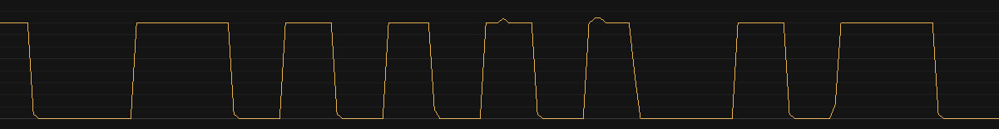
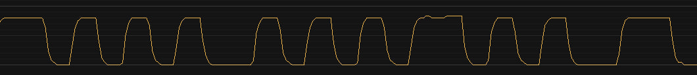
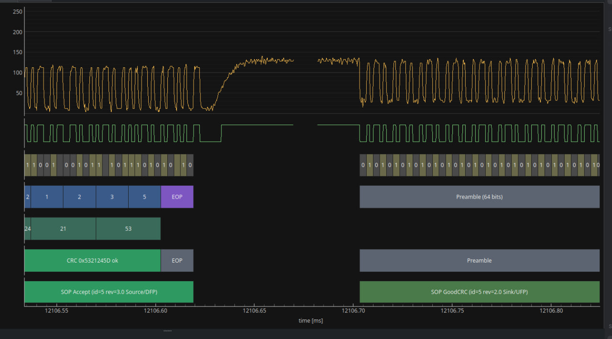
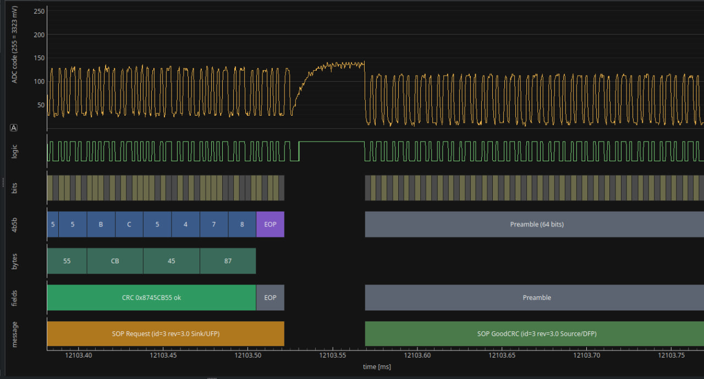

# Things I learned the hard way

Everything that broke on me while building this, more or less in order of how much time it ate.
If you build something similar, maybe this saves you a few evenings :P

## Signal and analog stuff

### My edges were too sharp

My sinks rejected every single frame, and on the sniffer my frames looked exactly like the ones from a working charger.
I was debugging this for a few days.

Turns out the edges straight from a GPIO are under 125 ns and they ring on the wires.
My 5-8 MHz sniffer just can't see that.
The spec wants at least 300 ns, so I added 2.2 nF from each CC line to ground, which gives about
330 ns - and it started working.

2.2 nF is more than the spec allows for cReceiver (600 pF), so it's not the final value, but it
works with everything I have.

*Before - no sink heard this.*

*After 2.2 nF - works with every sink I have.*

### Ground offset - the sink stops hearing me under load

The more current flowed, the worse the sink heard me.
First the IP2721 trigger board stopped answering at 1.6 A, later my Samsung went deaf on a PPS step
to 10.2 V / 3.5-3.7 A: it didn't acknowledge my PS_RDY, didn't hear my Hard Reset, and 506 ms after
the Accept it sent its own Hard Reset.

The load current lifts the ground between me and the sink.
Part of that is my 0.05 Ohm shunt (about 54 mV per amp), but most of it is the cable: the GND wire
in my "5 A cable with e-marker" is 0.09 Ohm, so about 0.3 V at 3 A.
The phone saw my high level at around 0.65 V, and the spec only guarantees decoding above 0.64 V.

What I did:

- The TX low leg gets tied by a transistor to the receptacle ground (GND_CC, a thin wire with no
  load current on it) instead of the ESP ground. That takes the shunt out of the picture, but not the cable.
- The main fix: GPIO6 raises the TX voltage when the current is high. 47R under the emitters of both
  TX transistors, shorted by a BC547, and a second BC547 that raises the comparator's Vref.
  It turns on from 2 A and off below 1.5 A. TX high goes from 1.18 to about 1.43 V and Vref from 0.55 to 0.76 V.
  Raising the swing for good would be out of spec (vSwing is 1.05-1.2 V), so it only happens when
  the ground offset eats it anyway.

Now the Samsung charges at 4.35 A, which is the most it asks for (the source offers up to 5 A).

### Rd reading goes up with the current

At 3 A the ADC read the phone's Rd at 2007-2067 mV, right at my old "line is open" threshold of 2000 mV.
Two readings like that and the charger would drop the phone in the middle of charging.
Now "open" is 2600 mV with the 3 A Rp and 2200 mV with the 1.5 A Rp.

### Switched Rp without diodes

In SinkTxNG (1.5 A) the sink still saw 3 A.
Both Rp legs come from GPIOs shared by the two CC lines, so the released leg just joined the lines together.
A BAT85 in every leg (anode at the pin) fixed it.

### VBUS shorted to CC

In a broken cable or receptacle CC sits right next to VBUS, so a GPIO can get 20 V.
VCONN also puts 5 V on CC, on purpose.
So each line has a 2N7000 in series, and a third 2N7000 as a "replica" sets the gate voltage, so the
line gets cut at about 3.3 V no matter what threshold the transistors have.
With 10k under the replica the gates were too low and each 2N7000 had a few hundred Ohm in series with CC, so it's 15k now. More in [hardware.md](hardware.md).

### Ghost currents from the INA219

After a charging session, with the VBUS switch open, the current showed 0.76, 1.53, 3.81 or 4.58 A.
After a reset it was fine. I was sure the module was broken.

It wasn't. The raw values were exactly k x 0x1000.
Near zero current some of the 16 averaged samples are slightly negative, and the chip's averaging
counts them as unsigned, so every negative sample adds about 0x1000.
The fix: I turned off the averaging in the INA219 (1 sample per conversion) and now average the
readings myself in the firmware.

### The inductor gets hot, not the heatsink

At 4 A the hottest part of the XL4015 is the inductor, and my thermistor was on the heatsink, so the
derating never saw it. With the fan pointed at the inductor it stays at 62 C.

But putting the thermistor on the inductor was worse. Its wires picked up noise from the winding
(it's the switching node) and put it on CC, and the phone stopped seeing the charger as a charger at
all - it showed a message about an analog audio accessory instead.
So the thermistor went back on the heatsink, and the fan points at the inductor.

### The ESP32 ADC

VBUS readings moved by about 50 mV from boot to boot, even with a simple calibration at boot.
The fix: a much bigger calibration at every boot, with a whole calibration table (9 points from 5 to
21 V, set by the DAC and read back), and averaging a lot more samples per reading.

## Microcontroller

### RMT lost frames

Every fifth Request got rejected.
I had two RMT RX channels with 96 codes each, a Request didn't fit, and the driver couldn't copy
half of the channel memory in time.
Now it's one channel with the whole memory (192 codes), and its input gets routed to the attached CC line at attach.

### GoodCRC came too late

My GoodCRC came 276 us after the frame, and the limit (tTransmit) is 195 us.
Two reasons: RMT was started by a GPIO interrupt on the first edge, so it lost the beginning, and
the code ran from a cold flash cache (up to 133 us).

Now RMT is armed all the time, the port, the PHY and the decoder run from IRAM, and every possible
GoodCRC is prepared in advance (8 MessageIDs x 2 SOP x 2 revisions, only 32 frames).
My GoodCRC now starts about 50 us after the frame, and the Samsung needs about 84 us for its own :D

*Samsung's GoodCRC after my message.*

*My GoodCRC after the phone's Request - about 1.7x faster.*

### Protocol bugs

The firmware had its share of protocol bugs too: two messages colliding, Hard Reset handling, PPS
Current Limit, a wireless charger whose preamble starts in an odd way.
They're all fixed, and they'll be described with the code once the library is out.

### The ESP32-S3 board

- My board was sold as ESP32-S3-N16R8 but it has no PSRAM, and PSRAM init just hung the boot
  (`espflash board-info` shows no PSRAM). The flash frequency also has to match the bootloader (40 MHz DIO).
- GPIO45 (fan) is a strapping pin and has to be low at reset.

## Devices and tools

### Sinks are weird

- The IP2721 trigger board transmits out of spec: its high level is 1.4-1.7 V, and right before its
  preamble it drives up to 2.2-3 V. It also takes my Source_Capabilities only on the third try.
- The Samsung answers Get_Manufacturer_Info with the string "Not Supported", and reports every
  battery capacity as 0xFFFF.

### CC dropping to 0 V

A few times CC1 dropped to 0 V and the charger saw a detach.
I measured it while it happened, and the line was pulled down outside my board (cable or trigger board).
So detach and VBUS off was the right answer.

### Sniffer ground

The sniffer's ground has to be on the shunt side (IN-).
Otherwise the PC's USB ground goes around the shunt and all the measurements are wrong.
